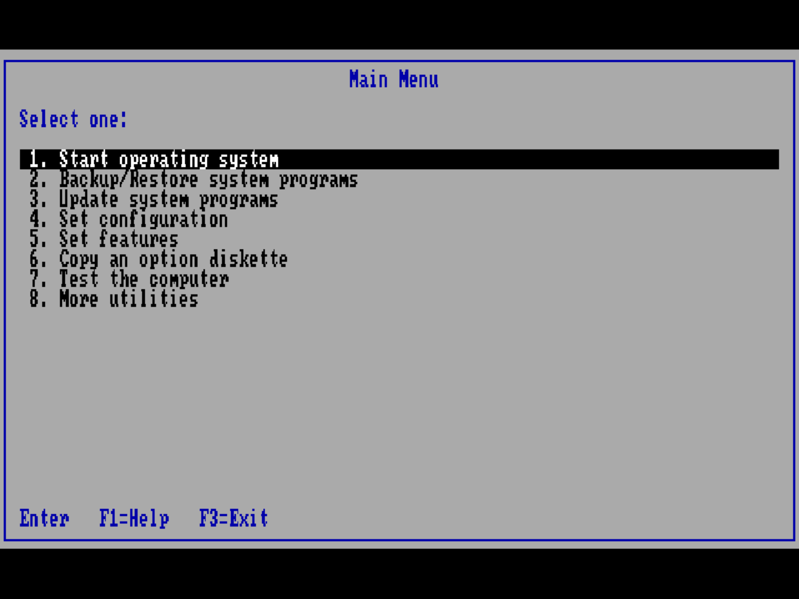
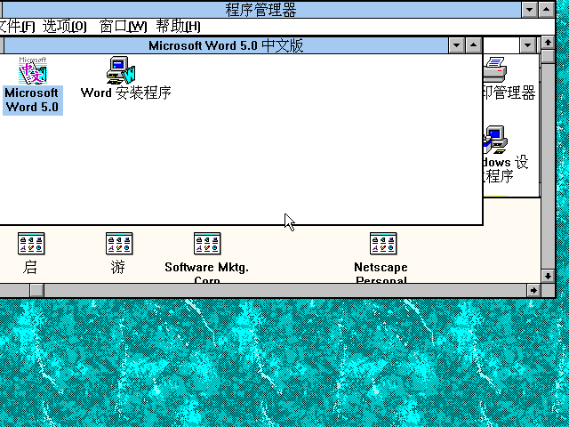
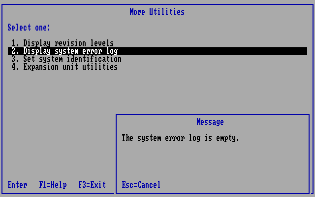
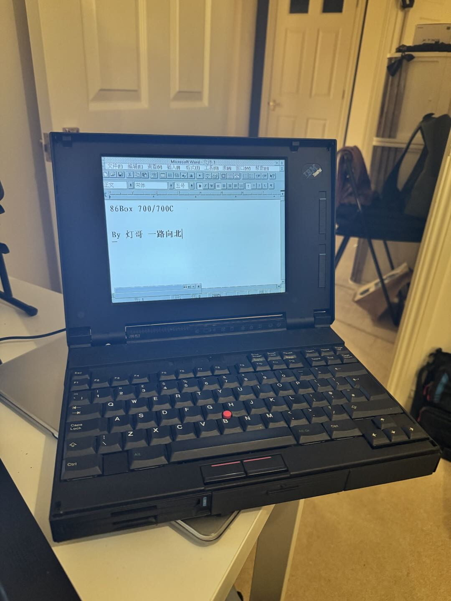

# 86Box ThinkPad 700 / 700C

[English](README.md) | [简体中文](README.zh-CN.md)

Experimental IBM ThinkPad 700 and 700C (type 9552) emulation, based on
**86Box 6.0, upstream commit `4fef696a4`**. This fork implements the planar,
IBM 486SLC, MCA ESDI boot path and LCD behavior needed to use the original IBM
Reference Diskette and period software.



The public repository provides source, configuration templates, tools and selected
screenshots. **BIOS ROMs, Reference/Diagnostic Diskettes, operating systems and
hard-disk images are not included.** Supply your own legally obtained files.
Local runnable bundles belong in the ignored `private-dist/` directory.

## Latest update — 2026-11-13

- Independent 700C firmware identity, matching Reference Diskette and 256-color Windows support.
- Correct LCD proportions and keyboard brightness/contrast, without on-screen controls.
- Firmware/storage fixes, dated boot verification, and a reproducible private handoff with a new README.

Details and verification limits are in [the update notes](docs/RELEASE-NOTES.md).

## Current status

| Area | Verified behavior |
| --- | --- |
| ThinkPad 700 | F1EE monochrome model; Reference Diskette boot regression |
| ThinkPad 700C | Independent F1EC model, original 39G9996 ROM identity and separate NVRAM |
| Firmware | POST, automatic configuration, revision/identity pages and an empty system error log |
| Storage | Integrated MCA ESDI; Reference Diskette → hard-disk hand-off |
| Color Windows | Windows 3.2 standard mode, IBM VGA256C 1.20 driver, 640×480, 8-bit scanout, 512 KiB VRAM |
| LCD | 4:3 fullscreen; centered 400-line text; full-height 480-line graphics |
| Controls | Keyboard-only brightness/contrast, with no controls or overlays on the guest display |
| Builds | Windows x64 Qt software and SDL builds; earlier 700 development on Linux ARM64 |

This remains an experimental community fork, without upstream review or claims of
cycle-exact behavior. Enhanced-mode Windows driver behavior, extended graphics
acceleration and the complete hardware diagnostic suite are **not yet verified**.
See the dated [verification record](docs/VERIFICATION.md) and
[change notes](docs/RELEASE-NOTES.md).

## Choose the correct machine and media

| Setting | ThinkPad 700 | ThinkPad 700C |
| --- | --- | --- |
| UI machine | [MCA] IBM ThinkPad 700 (9552) | [MCA] IBM ThinkPad 700C (9552) |
| Internal name | `ibmtp700` | `ibmtp700c` |
| Planar identity | F1EE | F1EC |
| ROM-relative path | `machines/ibmtp700/39G9996.bin` | `machines/ibmtp700c/39G9996.bin` |
| Reference Diskette 1.20 | `r700m120` | `r700c120` |
| System programs | `$0007000.IML` | `$0009000.IML` |
| Configuration | [700 template](configs/thinkpad700/86box.cfg.example) | [700C template](configs/thinkpad700c/86box.cfg.example) |

The preserved 256 KiB `39G9996` dump belongs to the 700C. The 700C uses it
unchanged; the 700 path converts the planar-ID operands and repairs checksums
**in the loaded copy only**. It never modifies the user's ROM file.

The 700C Reference Diskette contains `PF1EC.ADF`, `SF1EC.ADF` and
`$0009000.IML`. Keep each model's writable media and NVRAM separate.
Do not substitute the monochrome disk or run the 700-specific media patcher on
700C media. The normal 86Box font ROM tree is also needed; the tested local
bundle includes `video/mda/mda.rom` under the ROM root.

### Set up and boot

1. Copy the appropriate configuration template into a new VM folder as
   `86box.cfg`.
2. Supply a ROM root with the model-relative path shown above.
3. In the VM configuration, set your working hard-disk and Reference Diskette
   paths. The tested setup uses IBM 486SLC/25, 16 MiB RAM, internal video,
   PS/2 mouse, integrated MCA ESDI and a 3.5-inch 1.44 MB floppy.
4. Keep the correct Reference Diskette in drive A:. A cold start enters it
   first; select **Start operating system** for the hard-disk hand-off.

The tested disk geometry is **370 cylinders × 64 heads × 32 sectors**.
The IBM hidden system partition and matching IML programs are required;
an arbitrary DOS disk alone does not reproduce this boot path.

For a fresh or converted 700C working disk, use the 700C Reference Diskette's
**Backup/Restore system programs → Restore the system partition**, supplying
the common 700/700C/720/720C Diagnostic Diskette when requested. Then run
**Set configuration → Run automatic configuration**. Work on copies and keep
the original images intact.

Launch from PowerShell after building:

```powershell
& .\build\windows-700c\src\86Box.exe -F -R "C:\path\to\roms" -P "C:\path\to\ThinkPad 700C"
```

The equivalent Linux form is:

```bash
./build/linux/src/86Box -F -R /path/to/roms -P "/path/to/ThinkPad 700C"
```

`-R` points directly to the ROM root containing `machines/` and `video/`;
`-P` points to the VM folder containing `86box.cfg`.

### Install the 700C Windows color driver

The **700C120 VGA256C driver 1.20** is a different disk from the
**R700C120 Reference Diskette**. IBM's
[driver installation instructions](https://basterfield.com/pccbbs/mobiles/700c120.txt)
require `VESA.COM` before Windows and the
**640x480x256 Small fonts 512k IBMVGA256c** selection.

The local Windows 3.2 standard-mode installation was checked for 640×480,
8-bit scanout and 512 KiB VRAM. A generated 256-color bitmap was displayed
in Paintbrush; Windows' reserved palette maps some input colors together.




## Display and keyboard controls

The 700C uses the guest VGA palette without grayscale or a monochrome tint.
Its physical panel is represented as a fixed 640×480, 4:3 display.
By default, 640×400 Reference Diskette text is centered with 40 unused panel
rows above and below. True 640×480 Windows graphics fills the panel.

To reproduce the optional expanded text mode, enable **LCD vertical expansion**
in the 700C machine configuration (`lcd_vertical_expansion = 1`).
The supplied template uses `0`, consistent with the default described in
[IBM's Quick Reference](https://macdat.net/files/pdf/ibm/user_manuals/thinkpad_700_ps2_quick_reference.pdf).
See also [IBM's original specifications](https://oldthinkpad.com/static/pdf/ibm-thinkpad700xps2.pdf).

With the emulator focused, the Qt software renderer and SDL frontend support:

| Shortcut | Action |
| --- | --- |
| Ctrl+Shift+F5 / F6 | Decrease / increase LCD brightness |
| Ctrl+Shift+F7 / F8 | Decrease / increase LCD contrast |
| Ctrl+Shift+F9 | Restore the original colors, brightness/contrast 100 |
| Ctrl+End | Release the mouse |
| Ctrl+Alt+Page Up | Toggle fullscreen in the SDL frontend |

LCD adjustments affect guest RGB output only. There are no added controls,
numbers or overlays on the guest screen, and host monitor settings are
unaffected. The function keys in those combinations are consumed by the host.
Settings are saved with the VM on normal exit. Other Qt renderers have not
been verified for these controls; use the Qt software renderer for this setup.

## Build

The [official 86Box build guide](https://86box.readthedocs.io/en/stable/dev/buildguide.html)
lists platform dependencies. This repository retains the upstream CMake build
system. Firmware and guest media are not required to compile the emulator.

### Windows x64

Use an MSYS2 **UCRT64** shell with GCC, Ninja, CMake, Qt5 static, SDL2 and
the dependencies listed in the build guide. The exact CI dependency list is in
[the Windows release workflow](.github/workflows/windows_x64_release.yml).

```bash
git clone https://github.com/Deng-ge-open-source/86Box-Thinkpad700_700C.git
cd 86Box-Thinkpad700_700C
cmake -S . -B build/windows-700c --preset regular \
  --toolchain ./cmake/flags-gcc-x86_64.cmake \
  -DNEW_DYNAREC=OFF -DQT=ON
cmake --build build/windows-700c --parallel 4
```

The tested executable is `build/windows-700c/src/86Box.exe`.
For the SDL frontend, configure another build directory with `-DQT=OFF`.
Portable CI artifacts contain the emulator and public documentation, without
ROMs or installed guests. Dynamic builds may also need their dependency DLLs.

### Linux

Install your distribution's dependencies from the build guide, then:

```bash
cmake -S . -B build/linux --preset regular \
  --toolchain ./cmake/flags-gcc-x86_64.cmake
cmake --build build/linux --parallel 4
```

For Linux ARM64, use `cmake --preset flags-gcc-aarch64-regular` and build
`out/build/flags-gcc-aarch64-regular`; this enables the new recompiler.
The migrated 700 workstation can still use
[`scripts/launch-thinkpad700.sh`](scripts/launch-thinkpad700.sh) with its
ignored historical layout. That launcher and
`tools/thinkpad700/patch_tp700_media.py` are specific to the monochrome 700.

## Troubleshooting

| Observation | Check |
| --- | --- |
| Long power-on memory count | The measured 16 MiB POST takes about 38 seconds overall, including about 32 seconds at CP52. These are firmware checkpoints, not error codes. CP67 passed in under a millisecond in the local test. |
| Configuration or identity warning | Confirm F1EC/700C media and separate NVRAM; run the matching Reference Diskette configuration workflow. |
| `I9990303` on hard-disk boot | Check the hidden IBM system partition and model-specific IML programs. |
| Windows still uses 16 colors | Install the VGA256C driver and load `VESA.COM`; the Reference Diskette does not install the Windows driver. |
| Text looks too tall | Keep LCD vertical expansion off; 400-line text should have unused rows above and below. |

Normal builds no longer perform the diagnostic full-RAM IML signature scans in
the CPU loop. Original POST tests remain enabled. A fresh empty system error
log is initialized correctly; existing non-empty logs are preserved.



## Development and private handoff

```text
src/                         Emulator source and ThinkPad implementations
configs/thinkpad700*/         Public configuration templates
docs/                        Verification, technical notes and selected images
scripts/                     Launch and private packaging helpers
tools/thinkpad700/            Media, panel and validation tools
local-assets/                Ignored local firmware, media, state and toolchains
build/                       Ignored generated builds
private-dist/                Ignored private runtime and handoff archives
```

Before handing off changes, run `git diff --check`, build the relevant target
and boot the affected ThinkPad with local assets. The public-tree check and
focused DMA regression are described in [the verification record](docs/VERIFICATION.md).
Keep `README.md` and `README.zh-CN.md` synchronized.

For an existing local 700C runtime, use
[`scripts/package-private-thinkpad700c.ps1`](scripts/package-private-thinkpad700c.ps1)
to create a new private handoff with a fresh README, source snapshot and
checksums. The script copies an explicit file list and excludes logs, captures,
credentials and toolchains. Its output stays under `private-dist/` and must
not be uploaded to GitHub.

## The physical 700 project



The original 700 enclosure houses modern hardware running the emulator.
The earlier [restoration and firmware notes](docs/DEVELOPMENT-NOTES.zh-CN.md)
document that work; the 700C path builds on the same emulated platform.

## License and attribution

GNU GPL v2 or later, retaining 86Box notices: [COPYING](COPYING),
[AUTHORS](AUTHORS), [upstream README](docs/UPSTREAM_README.md) and
[86Box](https://github.com/86Box/86Box).
This is an independent community project, unaffiliated with IBM, Lenovo or
the upstream 86Box project.
