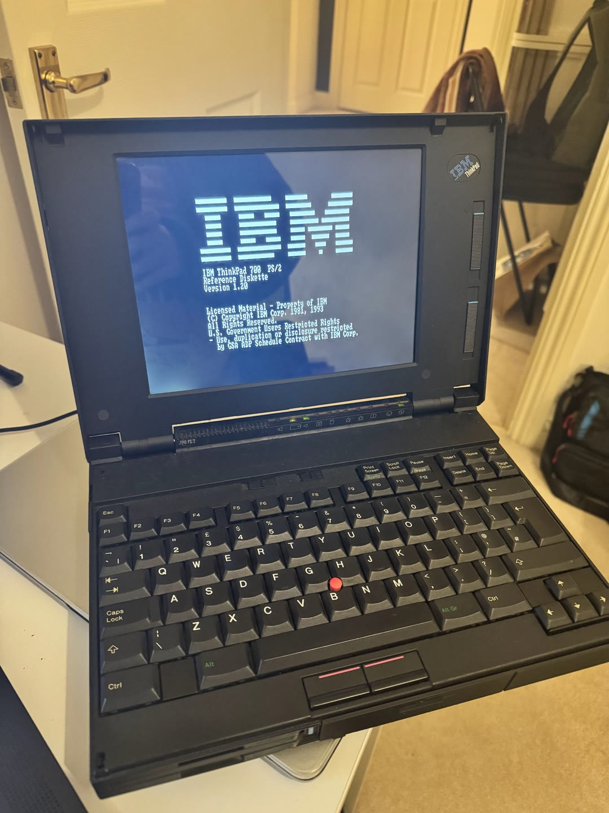
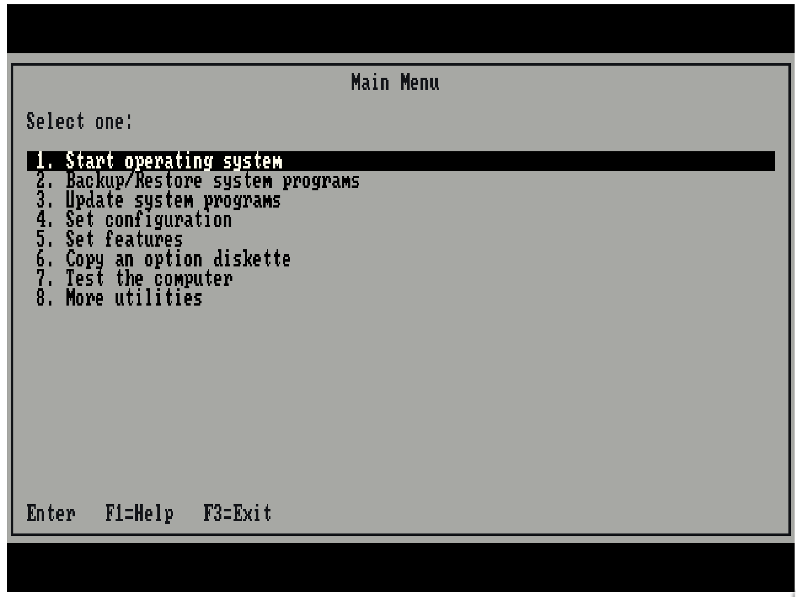

# 86Box ThinkPad 700 / 700C

[English](README.md) | [简体中文](README.zh-CN.md)

Experimental IBM ThinkPad 700 and 700C (type 9552) emulation built on 86Box 6.0.
This fork adds the machines, firmware-facing hardware behavior, IBM 486SLC support,
MCA ESDI boot path, monochrome and color LCD presentation, and the input/display fixes
needed to run the IBM Reference Diskette and a period operating system.


This is the project's physical ThinkPad 700: the original vintage enclosure
on the outside, modern hardware on the inside, and 86Box recreating the machine
it once was. The emulation reproduces the real 700's firmware-visible behavior
closely enough to complete POST, enter and use the IBM Reference Diskette,
perform automatic configuration, boot from its MCA ESDI hard disk, and run
period software in the genuine ThinkPad 700 shell. It brings the classic
machine's appearance and operation back to life while giving its internals a
modern, maintainable second life.



This is the startup screen of the original IBM ThinkPad 700 PS/2 Reference
Diskette, version 1.20, presented on the recreated machine just as it appears
on a real 700. This factory configuration and diagnostic environment exercises
the firmware paths that the project set out to preserve.



> [!IMPORTANT]
> This repository contains emulator source code only. IBM BIOS ROMs, Reference
> Diskettes, diagnostics, operating systems, hard-disk images, and other
> copyrighted software are **not** distributed here. Supply legally obtained
> copies yourself.

## Project status

- Base: 86Box 6.0, upstream commit `4fef696a4`.
- Machines exposed by the UI: `[MCA] IBM ThinkPad 700 (9552)` and
  `[MCA] IBM ThinkPad 700C (9552)`.
- Internal machine names: `ibmtp700` and `ibmtp700c`, with separate BIOS/NVRAM names.
- Primary tested guest: IBM Reference Diskette 1.20 and a 640×480 period
  Windows installation on a 370-cylinder MCA ESDI image.
- Original development host: Linux ARM64; the 700C path is also tested on
  Windows x64. The normal 86Box Windows and Linux build systems are retained.
- Status: experimental. The ThinkPad 700 and 700C paths are usable, but have not yet
  received upstream review and should not be treated as cycle-exact hardware
  preservation.

This is an independent community project. It is not affiliated with or
endorsed by IBM, Lenovo, or the upstream 86Box project.

## Latest update — 2026-11-13

- Independent 700C firmware identity, matching Reference Diskette and 256-color Windows support.
- Correct LCD proportions and keyboard brightness/contrast, without on-screen controls.
- Firmware/storage fixes, dated boot verification, and a reproducible private handoff with a new README.

Details and verification limits are in [the update notes](docs/RELEASE-NOTES.md).

## What was implemented

The work is larger than a machine-table entry. The firmware exercises several
PS/2- and ThinkPad-specific paths that previously did not exist in 86Box.

### ThinkPad 700 planar and firmware

- Added the IBM ThinkPad 700 / 9552 machine definition and the `ibmtp700`
  runtime device.
- Added the monochrome `F1EE` planar identity used by the 700. The preserved
  `39G9996` image identifies the 700C (`F1EC`), so the emulator converts the six
  planar-ID operands in its loaded copy and repairs the affected 64 KiB bank
  checksums. The user's ROM file is never modified.
- Added the machine-specific ROM shadow behavior and the correct 128 KiB high
  ROM window at `FE0000h–FFFFFFh`, while retaining the full low shadow used by
  POST.
- Implemented the system-control, VPD/serial EEPROM, planar and storage status
  registers queried by firmware and the Reference Diskette.

### IBM 486SLC and memory behavior

- Added IBM 486SLC/25 selection and ThinkPad-specific CPU configuration.
- Implemented the SLC cache-control registers and the 16 KiB, four-way cache
  tag behavior used by POST diagnostics.
- Added interpreter and dynamic-recompiler handling for the firmware's control
  register, stack, interrupt and return sequences.
- Corrected 4 MiB onboard RAM plus expansion topology, the 16 MiB presence
  state, reserved-memory mapping, NVRAM/EBDA values, DMA invalidation and warm
  reset behavior.

### MCA ESDI, system partition and boot

- Extended the MCA ESDI controller with the command, geometry, status and
  power-management behavior required by the 9552 firmware.
- Added support for the 370-cylinder, 64-head, 32-sector geometry used by the
  tested image.
- Implemented the Reference Diskette to hard-disk hand-off and documented the
  hidden 3 MiB system partition / IML requirement behind `I9990303`.
- Added `tools/thinkpad700/patch_tp700_media.py`, which validates a local work
  copy, restores only the reserved system-partition area when necessary, and
  refuses unexpected media layouts. It does not contain IBM data.

### Keyboard, mouse and floppy

- Corrected 8042 command-parameter ordering and IRQ12 timing required by the
  PS/2 pointing-device initialization.
- Added the ThinkPad POST mouse negotiation behavior and reliable mouse release
  handling.
- Implemented the PS/2 floppy-controller power/status responses used by the
  diagnostic and Reference Diskette paths.

### LCD and host integration

- Added a fixed 640×480 LCD presentation for the ThinkPad 700 path.
- Centered 720×400 and 640×400 firmware/text modes without resizing the host
  window, with safe horizontal margins for POST, PC DOS and Reference Diskette
  text.
- Added nearest-neighbor grayscale rendering, brightness/contrast/inversion
  hooks, fullscreen handling, and a lightweight SDL software-texture path for
  ARM64 hosts without useful GL acceleration.
- Added optional JSON status output and the companion panel bridge under
  `tools/thinkpad700/panel/` for a physical ThinkPad-style LED/control panel.

### ThinkPad 700C color support

- Added a separate F1EC machine that uses the original 256 KiB `39G9996`
  firmware unchanged, with independent BIOS/NVRAM names and the matching
  700C Reference Diskette.
- Corrected VPD/system-identity checks, empty error-log initialization, MCA ESDI
  arbitration-level assignment and resumable READ BUFFER transfers. Existing
  non-empty error logs are preserved.
- Added the 512 KiB VGA256C display path, 90FB video POS identity and banked
  packed-pixel memory used by IBM's 256-color Windows driver.
- Centered 400-line text on the 640×480 color panel, with optional vertical
  expansion, and added keyboard-only brightness and contrast controls.
- Excluded full-RAM IML diagnostic scans from normal CPU execution while
  retaining the original firmware POST tests.

### Verified firmware results

The local test system completed POST, entered the Reference Diskette, performed
automatic configuration, handed off to the hard disk and entered Windows. The
implementation fixes the device/configuration causes of the observed `00160`,
`00164`, `00169`, `00201`, `12902`, `08611`, `00191` and `I9990303` reports;
it does not hide their strings or bypass the corresponding firmware tests.

The 700C has also been verified through automatic configuration, revision and
identity pages, an empty system error log, and Windows 3.2 standard mode with
640×480, 8-bit scanout and 512 KiB VRAM. Windows enhanced mode, extended graphics
acceleration and the complete IBM hardware diagnostic suite remain unverified.
See the dated [verification record](docs/VERIFICATION.md) for those results.

See [the detailed development record](docs/DEVELOPMENT-NOTES.zh-CN.md) for the
original verification notes and [the upstream README](docs/UPSTREAM_README.md)
for general 86Box information.

## Repository layout

```text
src/                         86Box source plus ThinkPad 700/700C changes
cmake/, CMakeLists.txt       upstream build system
configs/thinkpad700/         redistributable monochrome configuration template
configs/thinkpad700c/        redistributable color configuration template
docs/                        technical notes and selected screenshots
scripts/                     local launch helpers
tools/thinkpad700/           deterministic media and panel tools
local-assets/                ignored local ROMs/media/runtime data
build/                       ignored build output
private-dist/                ignored private runtime and handoff packages
```

`local-assets/` is deliberately excluded by `.gitignore`. On the original
development machine it also holds historical research, locally owned media and
the migrated runtime. None of it should be added with `git add -f` unless its
license and redistribution rights have been checked independently.

## Required user-supplied files

### ThinkPad 700 monochrome configuration

At minimum, machine startup requires a legally obtained 256 KiB firmware dump
at this ROM-relative path:

```text
roms/machines/ibmtp700/39G9996.bin
```

The filename and location matter because 86Box ROM paths are hardcoded. You
will also need your own bootable floppy or disk image. For the fully verified
Reference Diskette workflow, provide your own Reference Diskette image and a
compatible ESDI hard-disk image containing the required IBM system partition.

Do not run the media helper on your only copy. Work on copies and keep known
hashes/backups of the originals.

### ThinkPad 700C color configuration

| Setting | ThinkPad 700 | ThinkPad 700C |
| --- | --- | --- |
| UI machine | [MCA] IBM ThinkPad 700 (9552) | [MCA] IBM ThinkPad 700C (9552) |
| Internal name | `ibmtp700` | `ibmtp700c` |
| Planar identity | F1EE | F1EC |
| ROM-relative path | `machines/ibmtp700/39G9996.bin` | `machines/ibmtp700c/39G9996.bin` |
| Reference Diskette 1.20 | `r700m120` | `r700c120` |
| System programs | `$0007000.IML` | `$0009000.IML` |
| Configuration | [700 template](configs/thinkpad700/86box.cfg.example) | [700C template](configs/thinkpad700c/86box.cfg.example) |

The preserved 256 KiB `39G9996` dump belongs to the 700C. The 700C uses it
unchanged; the 700 path converts the planar-ID operands and repairs checksums
**in the loaded copy only**. It never modifies the user's ROM file.

The 700C Reference Diskette contains `PF1EC.ADF`, `SF1EC.ADF` and
`$0009000.IML`. Keep each model's writable media and NVRAM separate.
Do not substitute the monochrome disk or run the 700-specific media patcher on
700C media. The normal 86Box font ROM tree is also needed; the tested local
bundle includes `video/mda/mda.rom` under the ROM root.

#### Set up and boot

Keep the matching 700C Reference Diskette in drive A: so cold boot enters it
first; select **Start operating system** for the hard-disk hand-off. The IBM
hidden system partition and model-specific IML programs are required; a plain
DOS disk alone does not reproduce this boot path.

For a fresh or converted 700C working disk, use the 700C Reference Diskette's
**Backup/Restore system programs → Restore the system partition**, supplying
the common 700/700C/720/720C Diagnostic Diskette when requested. Then run
**Set configuration → Run automatic configuration**. Work on copies and keep
the original images intact.

#### Boot a physical USB floppy on Windows

The Windows build can read a standard 720 KiB, 1.44 MB or 2.88 MB 3.5-inch disk
through a host floppy drive. The drive must support the inserted disk's format.
The guest always sees a **write-protected** disk; writing and formatting the
physical medium are not implemented. Keep the model's matching Reference
Diskette in the drive, or use a bootable DOS disk.

For a host drive assigned `A:`, set these entries in the VM's existing
`[Floppy and CD-ROM drives]` section:

```ini
fdd_01_type = 35_2hd
fdd_01_fn = ioctl://\\.\A:
fdd_01_host_device = \\.\A:
fdd_host_buffering = 1
```

Cold boot then reads the physical disk through the emulated floppy controller.
Windows must already be running; the 700/700C ROM executes inside 86Box.
The selection survives a restart. After swapping disks, remount the drive using
**Media → Floppy → Use Host Floppy Drive**, or restart the VM, to discard its
temporary track cache. Windows device access may require an elevated process.
This does not provide USB passthrough or low-level physical-drive diagnostics.
The 700C Reference Diskette has been booted from a TEAC USB UF000x drive on
Windows x64; see the [physical-media verification](docs/VERIFICATION.md#windows-physical-usb-floppy--2026-11-13).

#### Install the 700C Windows color driver

The **700C120 VGA256C driver 1.20** is a different disk from the
**R700C120 Reference Diskette**. IBM's
[driver installation instructions](https://basterfield.com/pccbbs/mobiles/700c120.txt)
require `VESA.COM` before Windows and the
**640x480x256 Small fonts 512k IBMVGA256c** selection.

The local Windows 3.2 standard-mode installation was checked for 640×480,
8-bit scanout and 512 KiB VRAM. A generated 256-color bitmap was displayed
in Paintbrush; Windows' reserved palette maps some input colors together.


#### Color LCD proportions

The 700C uses the guest VGA palette without grayscale or a monochrome tint.
Its physical panel is represented as a fixed 640×480, 4:3 display.
By default, 640×400 Reference Diskette text is centered with 40 unused panel
rows above and below. True 640×480 Windows graphics fills the panel.

To reproduce the optional expanded text mode, enable **LCD vertical expansion**
in the 700C machine configuration (`lcd_vertical_expansion = 1`).
The supplied template uses `0`, consistent with the default described in
[IBM's Quick Reference](https://macdat.net/files/pdf/ibm/user_manuals/thinkpad_700_ps2_quick_reference.pdf).
See also [IBM's original specifications](https://oldthinkpad.com/static/pdf/ibm-thinkpad700xps2.pdf).


#### Firmware checks and startup time

The 700C Reference Diskette's **More utilities → Display system error log**
opens normally on the tested configuration and reports an empty log.


The measured 16 MiB POST takes about 38 seconds, including about 32 seconds
of memory checking at CP52. CP67 passed within the millisecond timer resolution
in the local test; the reported intermittent stall was not reproduced.
The checkpoints are firmware progress indicators, and the original tests remain enabled.

## Build on Linux

The following Ubuntu/Debian packages match the official 86Box build guide:

```bash
sudo apt update
sudo apt install build-essential cmake extra-cmake-modules pkg-config \
  ninja-build libfreetype-dev libsdl2-dev libpng-dev libopenal-dev \
  librtmidi-dev libfluidsynth-dev libsndfile1-dev libserialport-dev \
  qtbase5-dev qtbase5-private-dev qttools5-dev libevdev-dev \
  libxkbcommon-dev libxkbcommon-x11-dev libslirp-dev
```

Configure and build a normal x86-64 Linux release:

```bash
git clone https://github.com/Deng-ge-open-source/86Box-Thinkpad700_700C.git
cd 86Box-Thinkpad700_700C
cmake -S . -B build/linux -G Ninja \
  -DCMAKE_BUILD_TYPE=Release \
  -DCMAKE_TOOLCHAIN_FILE=cmake/flags-gcc-x86_64.cmake
cmake --build build/linux -j"$(nproc)"
```

For an ARM64 Linux host, enable the new recompiler and use the included ARM64
toolchain preset:

```bash
cmake --preset flags-gcc-aarch64-regular
cmake --build out/build/flags-gcc-aarch64-regular -j"$(nproc)"
```

The executable is normally under the selected build directory's `src/`
subdirectory. If the preset is unsuitable for your distribution, configure a
plain Ninja directory and add `-DNEW_DYNAREC=ON`.

## Build on Windows

The most reproducible native Windows route is an **MSYS2 UCRT64 or MINGW64**
shell. Update MSYS2, then install the dependencies listed by the official 86Box
build guide:

```bash
pacman -Syu
pacman -S --needed git \
  $MINGW_PACKAGE_PREFIX-ninja \
  $MINGW_PACKAGE_PREFIX-cmake \
  $MINGW_PACKAGE_PREFIX-gcc \
  $MINGW_PACKAGE_PREFIX-pkgconf \
  $MINGW_PACKAGE_PREFIX-openal \
  $MINGW_PACKAGE_PREFIX-freetype \
  $MINGW_PACKAGE_PREFIX-SDL2 \
  $MINGW_PACKAGE_PREFIX-zlib \
  $MINGW_PACKAGE_PREFIX-libpng \
  $MINGW_PACKAGE_PREFIX-rtmidi \
  $MINGW_PACKAGE_PREFIX-fluidsynth \
  $MINGW_PACKAGE_PREFIX-libslirp \
  $MINGW_PACKAGE_PREFIX-libsndfile \
  $MINGW_PACKAGE_PREFIX-libserialport \
  $MINGW_PACKAGE_PREFIX-qt5-static \
  $MINGW_PACKAGE_PREFIX-qt5-translations \
  $MINGW_PACKAGE_PREFIX-vulkan-headers
```

Build from the same MSYS2 shell:

```bash
git clone https://github.com/Deng-ge-open-source/86Box-Thinkpad700_700C.git
cd 86Box-Thinkpad700_700C
cmake -S . -B build/windows-700c --preset regular \
  --toolchain ./cmake/flags-gcc-x86_64.cmake \
  -DNEW_DYNAREC=OFF -DQT=ON
cmake --build build/windows-700c -j"$(nproc)"
```

Locate `86Box.exe` below `build/windows-700c/`. Dynamic builds also need their
dependency DLLs. The [Windows release workflow](.github/workflows/windows_x64_release.yml)
lists the tested UCRT64 dependencies and produces portable public artifacts
without firmware or installed guests. CI also builds Windows ARM64 with MSYS2
CLANGARM64 and the new recompiler; ARM64 runtime behavior remains unverified.

## Configure and run a VM

You can import [`configs/thinkpad700/86box.cfg.example`](configs/thinkpad700/86box.cfg.example)
or use the [700C color template](configs/thinkpad700c/86box.cfg.example).
The common hardware settings are:

| Setting | Value |
| --- | --- |
| Machine | `[MCA] IBM ThinkPad 700 (9552)` or `[MCA] IBM ThinkPad 700C (9552)` |
| CPU | IBM 486SLC/25 |
| Memory | 4 MiB initially; 16 MiB is the tested maximum |
| Video | Internal |
| Mouse | PS/2 |
| Storage controller | Integrated MCA ESDI |
| Tested disk geometry | 370 cylinders, 64 heads, 32 sectors |
| Floppy | 3.5-inch 1.44 MB |

Place the ROM tree either under the VM path or pass it explicitly:

```bash
./build/linux/src/86Box -R /path/to/rom-root /path/to/vm/86box.cfg
```

On Windows PowerShell the equivalent shape is:

```powershell
& .\build\windows-700c\src\86Box.exe -R C:\path\to\rom-root C:\path\to\vm\86box.cfg
```

The exact executable subdirectory can vary with the generator. The `rom-root`
argument points directly to the ROM directory (such as `runtime/roms`) containing
`machines/ibmtp700/39G9996.bin`, or `machines/ibmtp700c/39G9996.bin` for the
color model, and the normal font tree such as `video/mda/mda.rom`.

## Original development-machine launcher

The migrated Linux workstation can still start the verified VM with:

```bash
./scripts/launch-thinkpad700.sh
```

That launcher expects the ignored historical layout under
`local-assets/legacy-work/`, validates/repairs only the local working copies,
sets the ROM path and starts the existing ARM64 build. Override the local data
location with `TP700_WORK_ROOT=/another/path` if needed.

The optional media tool can be run separately:

```bash
TP700_WORK_ROOT="$PWD/local-assets/legacy-work" \
  python3 tools/thinkpad700/patch_tp700_media.py
```

It intentionally fails on unexpected sizes, bytes, checksums or FAT layouts.
This launcher and media helper are specific to the monochrome 700; do not use
the patcher on 700C media.

## Controls

- Click the guest display to capture the mouse.
- `Ctrl+End` releases the mouse; the middle button is a fallback.
- `Ctrl+Alt+Page Up` toggles fullscreen in the SDL frontend.
- Exit fullscreen before using the host window close button.

The Qt software renderer and SDL frontend also support the following LCD keys
when the emulator has focus:

| Shortcut | LCD adjustment |
| --- | --- |
| Ctrl+Shift+F5 / F6 | Decrease / increase brightness |
| Ctrl+Shift+F7 / F8 | Decrease / increase contrast |
| Ctrl+Shift+F9 | Restore the original colors |

These controls affect guest RGB output only, with no added controls, values or
overlays on the guest screen and no change to the host monitor. The function
keys are consumed by the emulator; settings are saved on normal exit. Default
brightness and contrast are both 100. Use the Qt software renderer for this
setup; other Qt backends have not been verified for these controls.

## Development workflow

Keep all new source work in this repository. Generated builds, ROMs, VM state,
disk images, logs and capture sequences belong in ignored directories. Before
opening a pull request:

```bash
git diff --check
cmake --build <your-build-directory> -j2
```

Please describe which firmware path or hardware behavior a change implements,
and include reproducible logs or compact selected screenshots rather than raw
frame sequences.

Keep the English and Chinese README synchronized. Source-only checks and the
focused DMA regression are described in [the verification record](docs/VERIFICATION.md).
For an existing local 700C runtime,
[`scripts/package-private-thinkpad700c.ps1`](scripts/package-private-thinkpad700c.ps1)
creates a private handoff with a README, source snapshot and checksums.
The resulting bundles stay in ignored `private-dist/` and are not uploaded to GitHub.

## License and attribution

This fork retains the 86Box GNU GPL v2-or-later license and upstream notices;
see [`COPYING`](COPYING) and [`AUTHORS`](AUTHORS). New contributions to this
repository are distributed under the same license unless explicitly stated
otherwise in the relevant file.

Useful upstream references:

- [86Box project](https://github.com/86Box/86Box)
- [Official build guide](https://86box.readthedocs.io/en/stable/dev/buildguide.html)
- [ROM search paths](https://86box.readthedocs.io/en/latest/usage/roms.html)
