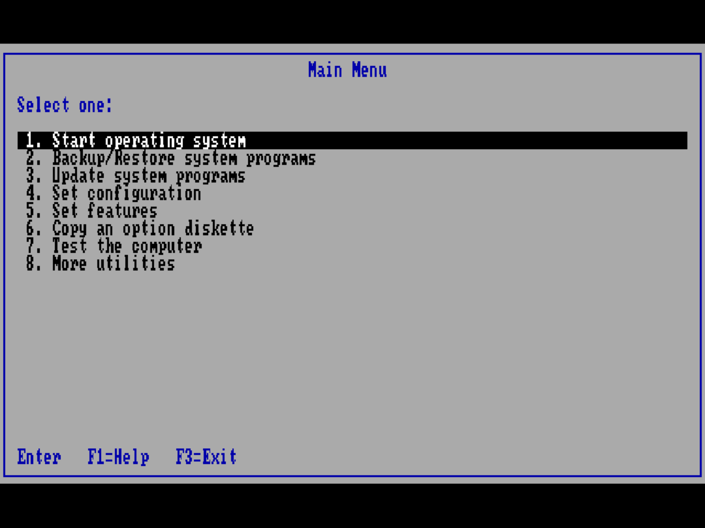
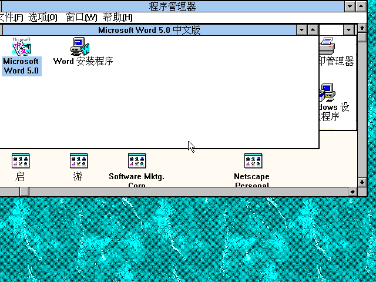
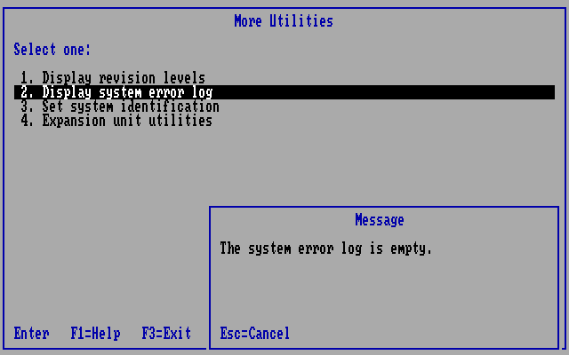
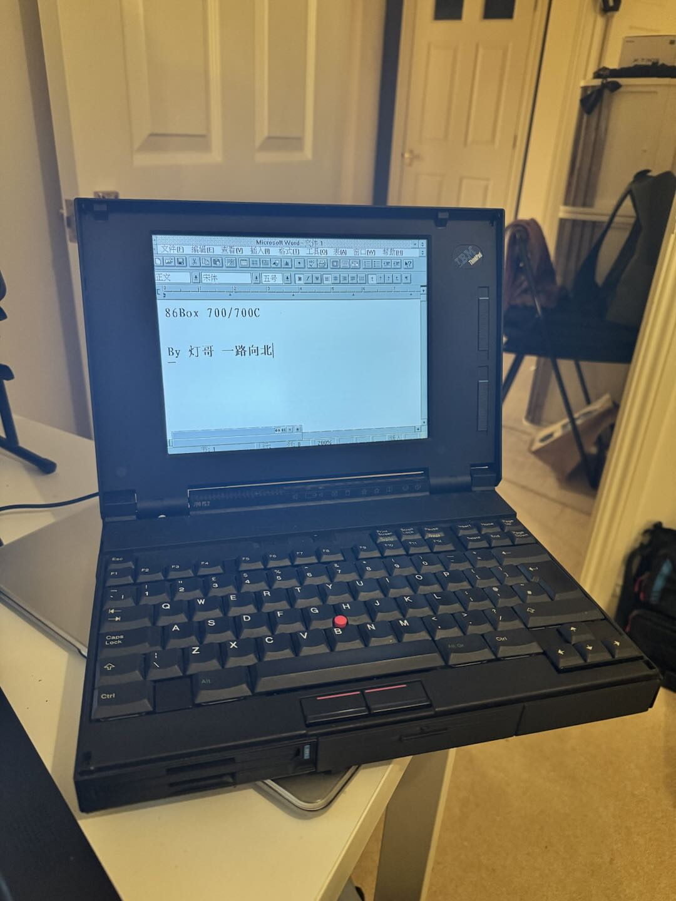

# 86Box ThinkPad 700 / 700C

[English](README.md) | [简体中文](README.zh-CN.md)

基于 **86Box 6.0，上游提交 `4fef696a4`** 的实验性 IBM ThinkPad 700 / 700C
（9552 型）模拟项目。本分支实现系统板、IBM 486SLC、MCA ESDI 启动链和 LCD 行为，
用于运行 IBM 原版参考盘及同时代软件。



公开仓库提供源码、配置模板、工具和精选截图，**不包含 BIOS ROM、参考盘、诊断盘、
操作系统或硬盘镜像**，请自行提供合法取得的文件。本地可运行整合包保存在 Git 忽略的
`private-dist/` 中。

## 本次更新 — 2026-11-13

- 700C 独立固件身份、对应参考盘和 256 色 Windows 支持。
- 修正 LCD 画面比例，使用纯键盘调节亮度/对比度，不增加屏幕控件。
- 固件/存储修复、带日期的启动验证，以及带全新 README 的可复现私人交接包。

具体修改与验证边界见[更新记录](docs/RELEASE-NOTES.md)。

## 当前状态

| 项目 | 已验证行为 |
| --- | --- |
| ThinkPad 700 | F1EE 单色机型；参考盘启动回归 |
| ThinkPad 700C | 独立 F1EC 机型，保留原始 39G9996 ROM 身份和独立 NVRAM |
| 固件 | POST、自动配置、版本/身份页面、空系统错误日志 |
| 存储 | 集成 MCA ESDI；参考盘到硬盘的启动交接 |
| 彩色 Windows | Windows 3.2 标准模式、IBM VGA256C 1.20 驱动、640×480、8 位扫描、512 KiB 显存 |
| LCD | 4:3 全屏；400 行文本居中，480 行图形铺满面板 |
| 控制 | 纯键盘亮度/对比度调节，客机画面无新增控件或叠加提示 |
| 构建 | Windows x64 Qt 软件渲染和 SDL；早期 700 开发使用 Linux ARM64 |

本项目仍为实验性社区分支，尚未经过上游审查，不宣称周期级精确模拟。
Windows 增强模式驱动、扩展视频加速和完整硬件诊断套件**尚未验证**。
详见[验证记录](docs/VERIFICATION.md)和[更新记录](docs/RELEASE-NOTES.md)。

## 选择正确的机型和介质

| 配置 | ThinkPad 700 | ThinkPad 700C |
| --- | --- | --- |
| 界面机型 | [MCA] IBM ThinkPad 700 (9552) | [MCA] IBM ThinkPad 700C (9552) |
| 内部名称 | `ibmtp700` | `ibmtp700c` |
| Planar 身份 | F1EE | F1EC |
| ROM 根目录下的路径 | `machines/ibmtp700/39G9996.bin` | `machines/ibmtp700c/39G9996.bin` |
| 参考盘 1.20 | `r700m120` | `r700c120` |
| 系统程序 | `$0007000.IML` | `$0009000.IML` |
| 配置 | [700 模板](configs/thinkpad700/86box.cfg.example) | [700C 模板](configs/thinkpad700c/86box.cfg.example) |

现存 256 KiB `39G9996` 固件转储属于 700C。700C 直接使用原始内容；700 路径只在
**加载后的内存副本**中转换系统板 ID 操作数并修复校验和，不修改用户 ROM 文件。

700C 参考盘包含 `PF1EC.ADF`、`SF1EC.ADF` 和 `$0009000.IML`。
两个机型的可写介质和 NVRAM 应分开，不要混用单色参考盘，也不要对 700C 介质运行
700 专用修复脚本。另需正常的 86Box 字体 ROM 树；实测本地包的 ROM 根目录包含
`video/mda/mda.rom`。

### 配置和启动

1. 将对应配置模板复制到新的虚拟机目录，命名为 `86box.cfg`。
2. 准备 ROM 根目录，内部路径与上表一致。
3. 在配置中设置硬盘工作副本和参考盘路径。实测配置为 IBM 486SLC/25、16 MiB、
   内部显卡、PS/2 鼠标、集成 MCA ESDI、3.5 英寸 1.44 MB 软驱。
4. 将对应参考盘保持挂载在 A:。冷启动先进入参考盘，再选择
   **Start operating system** 交接到硬盘。

实测硬盘几何参数为 **370 柱面 × 64 磁头 × 32 扇区**。
需要 IBM 隐藏系统分区及匹配的 IML 程序，仅有普通 DOS 硬盘不能复现这条启动链。

首次配置或转换 700C 硬盘工作副本时，在 700C 参考盘中选择
**Backup/Restore system programs → Restore the system partition**，
按提示提供 700/700C/720/720C 通用诊断盘，然后执行
**Set configuration → Run automatic configuration**。
只处理工作副本，保留原始镜像。

构建后可在 PowerShell 启动：

```powershell
& .\build\windows-700c\src\86Box.exe -F -R "C:\path\to\roms" -P "C:\path\to\ThinkPad 700C"
```

Linux 对应命令：

```bash
./build/linux/src/86Box -F -R /path/to/roms -P "/path/to/ThinkPad 700C"
```

`-R` 指向直接包含 `machines/`、`video/` 的 ROM 根目录；
`-P` 指向包含 `86box.cfg` 的虚拟机目录。

### 安装 700C Windows 彩色驱动

**700C120 VGA256C 1.20 驱动盘**与 **R700C120 参考盘**是不同的介质。
[IBM 原始驱动安装说明](https://basterfield.com/pccbbs/mobiles/700c120.txt)
要求在 Windows 前加载 `VESA.COM`，并选择
**640x480x256 Small fonts 512k IBMVGA256c**。

本地 Windows 3.2 标准模式已核对为 640×480、8 位扫描、512 KiB 显存。
画笔中已显示自行生成的 256 色测试位图；Windows 保留调色板会合并部分输入颜色。




## 显示与键盘控制

700C 直接使用客机 VGA 调色板，不叠加灰阶或单色染色。
物理面板以固定 640×480、4:3 显示区域模拟。默认将参考盘的 640×400 文本居中，
上下各留 40 行；Windows 的真正 640×480 图形铺满面板。

如需可选的文本展开效果，可在 700C 机型配置启用 **LCD vertical expansion**
（`lcd_vertical_expansion = 1`）。提供的模板使用 `0`，
与 [IBM Quick Reference](https://macdat.net/files/pdf/ibm/user_manuals/thinkpad_700_ps2_quick_reference.pdf)
中的默认设置一致。另见 [IBM 原始规格](https://oldthinkpad.com/static/pdf/ibm-thinkpad700xps2.pdf)。

模拟器获得焦点后，Qt 软件渲染和 SDL 前端支持：

| 快捷键 | 功能 |
| --- | --- |
| Ctrl+Shift+F5 / F6 | 降低 / 提高 LCD 亮度 |
| Ctrl+Shift+F7 / F8 | 降低 / 提高 LCD 对比度 |
| Ctrl+Shift+F9 | 恢复原始颜色，亮度/对比度均为 100 |
| Ctrl+End | 释放鼠标 |
| Ctrl+Alt+Page Up | 在 SDL 前端切换全屏 |

LCD 调节只改变客机 RGB 输出，不增加控件、数值或叠加提示，也不影响宿主显示器。
组合键中的功能键由宿主处理，不传给客机；正常退出时随虚拟机配置保存。
其他 Qt 渲染器尚未验证这些控制，本配置请使用 Qt 软件渲染。

## 构建

[86Box 官方构建指南](https://86box.readthedocs.io/en/stable/dev/buildguide.html)
列出各平台依赖。本仓库保留上游 CMake 构建系统，编译模拟器不需要固件或客机介质。

### Windows x64

使用 MSYS2 **UCRT64**，安装 GCC、Ninja、CMake、Qt5 static、SDL2 及官方指南中的依赖。
准确的 CI 依赖清单见 [Windows 发布构建工作流](.github/workflows/windows_x64_release.yml)。

```bash
git clone https://github.com/Deng-ge-open-source/86Box-Thinkpad700_700C.git
cd 86Box-Thinkpad700_700C
cmake -S . -B build/windows-700c --preset regular \
  --toolchain ./cmake/flags-gcc-x86_64.cmake \
  -DNEW_DYNAREC=OFF -DQT=ON
cmake --build build/windows-700c --parallel 4
```

实测可执行文件为 `build/windows-700c/src/86Box.exe`。
SDL 前端请使用另一构建目录并设置 `-DQT=OFF`。
CI 便携产物只含模拟器和公开文档，不含 ROM 或已安装客机。
动态链接构建还可能需要依赖 DLL。

### Linux

按官方指南安装发行版依赖，然后执行：

```bash
cmake -S . -B build/linux --preset regular \
  --toolchain ./cmake/flags-gcc-x86_64.cmake
cmake --build build/linux --parallel 4
```

Linux ARM64 使用 `cmake --preset flags-gcc-aarch64-regular`，然后构建
`out/build/flags-gcc-aarch64-regular`，该配置启用新重编译器。
迁移后的 700 工作站仍可通过
[`scripts/launch-thinkpad700.sh`](scripts/launch-thinkpad700.sh)
使用被忽略的历史目录布局。该启动器和
`tools/thinkpad700/patch_tp700_media.py` 专用于单色 700。

## 常见问题

| 现象 | 检查 |
| --- | --- |
| 开机内存计数较久 | 实测 16 MiB 完整 POST 约 38 秒，其中 CP52 内存检查约 32 秒。这些是固件检查点，不是错误码；CP67 在本地测试中不到 1 毫秒便通过。 |
| 配置或系统身份警告 | 确认 F1EC/700C 介质和独立 NVRAM，使用对应参考盘完成配置。 |
| 硬盘启动出现 `I9990303` | 检查 IBM 隐藏系统分区和对应机型 IML 程序。 |
| Windows 仍为 16 色 | 安装 VGA256C 驱动并加载 `VESA.COM`；参考盘不会安装 Windows 显卡驱动。 |
| 文本偏高 | 关闭 LCD vertical expansion；400 行文本上下应有未使用的面板区域。 |

正常构建已移除 CPU 循环中的全内存 IML 诊断扫描，保留原始 POST 检测。
新建空错误日志会正确初始化，已有的非空错误日志会保留。



## 开发与私人交接

```text
src/                         模拟器源码和 ThinkPad 实现
configs/thinkpad700*/         可公开的配置模板
docs/                        验证、技术记录和精选截图
scripts/                     启动与私人打包辅助脚本
tools/thinkpad700/            介质、面板和验证工具
local-assets/                被忽略的固件、介质、状态、工具链
build/                       被忽略的构建产物
private-dist/                被忽略的私人运行包与交接压缩包
```

交接源码前应执行 `git diff --check`、构建相关目标，并在本地介质可用时完成对应
ThinkPad 的启动验证。公开文件检查和针对 DMA 的回归命令见
[验证记录](docs/VERIFICATION.md)。英文和中文 README 应同步更新。

已有本地 700C 运行环境时，可使用
[`scripts/package-private-thinkpad700c.ps1`](scripts/package-private-thinkpad700c.ps1)
生成带全新 README、源码快照和校验值的私人交接包。脚本只复制明确列出的文件，
不带日志、连续截图、凭据或工具链。输出保存在 `private-dist/`，不要上传到 GitHub。

## 实体 700 项目



原始 700 外壳内部使用现代硬件运行模拟器。
早期[改造与固件开发记录](docs/DEVELOPMENT-NOTES.zh-CN.md)
记述了这部分工作，700C 在同一模拟平台上扩展。

## 许可证与致谢

采用 GNU GPL v2 或更新版本，并保留 86Box 声明：
[COPYING](COPYING)、[AUTHORS](AUTHORS)、[上游 README](docs/UPSTREAM_README.md)、
[86Box](https://github.com/86Box/86Box)。
本项目为独立社区项目，与 IBM、Lenovo 或 86Box 上游不存在隶属或官方认可关系。
